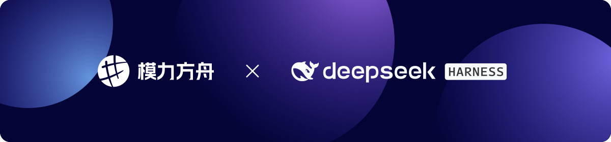

<div>
  <h1 align="center">dsh-moark</h1>
  <p align="center">
  Connect <a target="blank" href="https://moark.com">MoArk</a> to <a target="blank" href="https://github.com/deepseek-ai">DeepSeek Harness</a>
  </p>
  
</div>

<p align="center"><a href="./README.md">简体中文</a> | <strong>English</strong></p>

## Requirements

- DeepSeek Harness `0.2.1-rc.2` or a compatible `0.2.x`
- A MoArk access token (MoArk Console → Settings → Access Tokens)

## Installation

### DeepSeek Harness Desktop

Open `Settings → Built-in Plugins` and install `dsh-moark` from npm.

### DeepSeek Harness Web / CLI

```bash
dsh plugin --profile web add dsh-moark
```

Restart the corresponding DSH profile after installation, or refresh the page.

To use the CLI with Desktop, fully quit Desktop first:

```bash
dsh plugin --profile desktop add dsh-moark
```

> You do not need `npm install -g dsh-moark`; plugins are managed by DSH profiles.

## Quick Start

1. Create an access token in the [MoArk](https://moark.com) Console.
2. Open `Settings → MoArk`.
3. Choose a service region:
   - Mainland China: `https://api.moark.com/v1`
   - International: `https://api.moark.ai/v1`
   - Or a custom endpoint
4. Enter the access token. Leave it empty if a token is already saved.
5. Click `Fetch models` to load the chat models available to the current token.
6. Select the models to use in DSH; switch between card and list views as needed.
7. Click `Connect / Update`. The plugin writes the provider, waits for DSH to register it, and runs a streaming self-test.
8. Select **MoArk** and the desired model in the model selector.

If a token is already configured and the current profile has no `providers.moark`, opening the settings page automatically connects once with the default models.

## Settings

| Action | Description |
|---|---|
| Connect / Update | Write or update the MoArk provider; roll back automatically on failure |
| Test connection | Call the MoArk API directly to check the endpoint and token |
| Rollback | Restore the `llm-pi-ai` configuration from before this connection |
| Run self-test | Send a real request through DSH's LLM service |
| Fetch models | Load the chat models available to the current token |
| Add model | Enter a display name and model ID manually |

Model cards support:

- Click anywhere on a card to toggle whether the model is enabled;
- `Set as preferred default` at the bottom of a card: make this model the default for new DSH sessions when connecting;
- `Edit model`: change the display name, context window, maximum output tokens, and input types (text/image);
- Copy the model ID;
- Card and list views.

When context window and maximum output are empty, the `llm-pi-ai` defaults are used (262,144 / 32,768).
You can also keep using DSH's native `Settings → Models → MoArk` editor; the next update from this plugin preserves provider/model metadata changed in the native editor.

## What Gets Written

| Location | Content |
|---|---|
| DSH credentials | `MOARK_API_KEY` |
| `llm-pi-ai` | `providers.moark` |
| Default model (optional) | `agentDefaultModel` |

The plugin only merges `providers.moark`; it does not overwrite other providers.

## Security

- The access token is stored only in DSH's credential store; it is not written to the provider configuration, logs, or page storage;
- Plugin Host routes listen only on the local loopback interface;
- Create a dedicated MoArk token for DSH so it can be revoked at any time;
- Rollback only removes the provider. It does not delete the saved token; to replace it, overwrite it directly or clear it in credentials management.

## Troubleshooting

| Symptom | Fix |
|---|---|
| 401 / invalid token | Generate a new token in the MoArk Console and enter it |
| 400 resource package or quota error | Check the resource package balance, token binding, and model authorization |
| International site connection failure | Select the international region and use `https://api.moark.ai/v1` |
| Empty model list | Verify the token and region, then click `Fetch models` again |
| MoArk missing from the model selector after connecting | Run `Run self-test`; if it still fails, roll back and connect again |
| Desktop CLI installation fails | Fully quit Desktop, then run `dsh plugin --profile desktop add dsh-moark` |

## Uninstall

1. Click `Rollback` in the settings page to remove `providers.moark`.
2. Remove the plugin in `Settings → Built-in Plugins`, or run:

```bash
dsh plugin --profile web remove dsh-moark
```

3. To disable it completely, revoke the corresponding access token in the MoArk Console.

## License

[MIT](./LICENSE)
